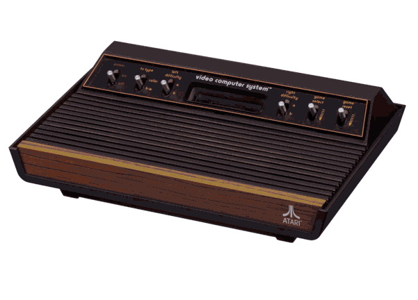

<h1 align="center">

<br>

<h4 align="center">

The Atari 2600 was a groundbreaking gaming console that took the world by storm in the late 1970s and early 1980s. This interactive and responsive webpage showcases the history of the Atari 2600, from its initial success to the end of its project. The webpage also includes a section on the hardware used in the construction of the 2600, including the circuits and controllers of the time
<br>
<br>
<a href="https://aragonxpd154.github.io/landing-page-atari-vcs-2600/">

</a>

</h4>

<p align="center">


<a href="https://github.com/aragonxpd154/landing-page-atari-vcs-2600/issues">
 
</a>

</a>
</p>

<p align="center">
<a href="#rocket-technologies">Technologies</a>&nbsp;&nbsp;&nbsp;|&nbsp;&nbsp;&nbsp;
<a href="#information_source">About</a>&nbsp;&nbsp;&nbsp;|&nbsp;&nbsp;&nbsp;
<a href="#memo-license">License</a>
</p>

<p align="center">

</p>

## :rocket: Technologies

This project is still in the development stage and using the following technologies

- HTML5, CSS3 and vanilla JavaScript (Canvas 2D + Web Audio API) — no build step, no dependencies
- [GoogleAPI Fonts](https://fonts.googleapis.com/css2?family=Poppins:wght@100;300;500&display=swap)

## :information_source: About

_The Atari 2600: A Journey Through Gaming History_

The Atari 2600 was a groundbreaking gaming console that took the world by storm in the late 1970s and early 1980s. This interactive and responsive webpage showcases the history of the Atari 2600, from its initial success to the end of its project. The webpage also includes a section on the hardware used in the construction of the 2600, including the circuits and controllers of the time. Finally, the webpage features a Demo Games page with six playable JavaScript remakes of 2600 classics — Pong, Breakout, Space Invaders, Asteroids, Freeway and River Raid — giving users a chance to relive the glory days of the 2600.

_The History of the 2600_

The 2600 was a revolutionary gaming console that brought the excitement of arcade games into homes all over the world. Upon its release in 1979, the 2600 quickly became one of the most popular gifts of the holiday season, with millions of units sold in its first year. The inclusion of the classic arcade game Space Invaders only added to the 2600's popularity, leading to sales doubling in the following year with over 2 million units sold. The 2600's success continued for two more years, with almost 8 million units sold by 1982. The 2600 remains an icon of the gaming industry and a timeless symbol of gaming history.

_The Hardware Behind the 2600_

The 2600 was much more than just a gaming console. It was a complex piece of hardware, incorporating advanced circuitry and controllers to deliver an unparalleled gaming experience. This section of the webpage explores the hardware behind the 2600, showcasing the technological innovations that made it possible. From the use of integrated circuits to the custom controllers, the 2600 pushed the boundaries of what was possible in home gaming.

_Demo Games: six Atari 2600 classics_

The **Demo Game** page shares the look of the home page (video background, Poppins, red buttons) and turns the screen into a little Atari console: pick a cartridge and play six classics, rebuilt from scratch in JavaScript as a tribute — no original ROMs or artwork are used.

| # | Game | Original release on the 2600 | Controls |
|---|------|------------------------------|----------|
| 01 | Pong | Video Olympics — Atari, 1977 | `W` `S` / `↑` `↓` (or mouse/finger) |
| 02 | Breakout | Atari, 1978 | `A` `D` / `←` `→`, `Space` launches |
| 03 | Invasores (Space Invaders tribute) | Atari, 1980 | `A` `D` / `←` `→`, `Space` fires |
| 04 | Asteroides (Asteroids tribute) | Atari, 1981 | `←` `→` rotate, `↑` thrust, `Space` fires, `↓` hyperspace |
| 05 | Freeway | Activision, 1981 | `W` `S` / `↑` `↓` |
| 06 | River Raid | Activision, 1982 | arrows move/accelerate/brake, `Space` fires |

Shortcuts: `Enter` starts, `P`/`Esc` pauses, `M` toggles sound. On phones and tablets an on-screen D-pad and FIRE button appear. High scores are saved in the browser (localStorage), and each game can be opened directly with a hash, e.g. `src/demo-game/index.html#riverraid`.

Code layout:

```
src/demo-game/
├── index.html          # page (same design as the home page)
├── css/style-game.css  # console, cartridges, touch controls
└── js/
    ├── engine.js       # game loop, input, sound, 3x5 pixel font, high scores
    ├── main.js         # wires the page UI to the engine
    └── games/          # one file per game: pong, breakout, invaders, asteroids, freeway, riverraid
```

To add a new game, create a file in `js/games/` that calls `Atari.register({ id, title, publisher, year, create(api) { return { update(input), draw(ctx) } } })` and add a `<script>` tag for it in `index.html`.

_Ongoing Improvements_

This project is constantly being improved and updated to provide the best possible experience for users. Whether you're a seasoned 2600 veteran or discovering the console for the first time, this webpage is sure to be a thrilling journey through gaming history.

## :memo: License

This project is under the GPL v3.0 license. See the [LICENSE](https://github.com/aragonxpd154/landing-page-atari-vcs-2600/blob/main/LICENSE) for more information.

---

Made with ♥ by Marcos (Obel) :wave: [Get in touch!](https://www.linkedin.com/in/marcosobel)
